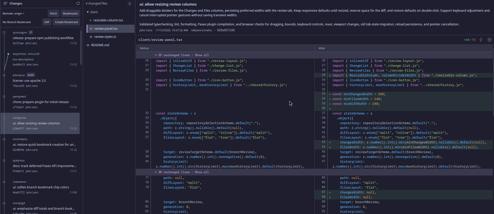

# jj Companion

Jujutsu workspaces, change history, bookmarks, and diff review for Paseo.



## Features

- **Diff review:** single changes, linear ranges, or your branch; inline or side-by-side views with
  syntax highlighting and expandable context.
- **Change graph:** browse history, descriptions, bookmarks, workspace labels, and conflicts.
- **Bookmarks:** create, tug, track, fetch, and push from the review tab.
- **Isolated workspaces:** create jj workspaces with or without Git colocation, with
  optional setup and teardown scripts.
- **Repository switching:** review separate jj repositories in immediate child directories.
- **Persistent layout:** resizable columns, tree/list file views, and saved tab selections.
- **Codex integration:** preserve configured writable roots and add the shared jj/Git paths.

The review interface works on desktop and web; native mobile diff review is not included.

## Requirements

- Paseo **0.17.1+**, with `pluginsEnabled: true` in its config.
- **jj 0.46.0+** and **Git 2.42+** on the daemon's PATH for normal use.
- A jj repository, colocated or non-colocated.

All commands run on the machine hosting the Paseo daemon.

## Install

```bash
paseo plugin install npm:paseo-jj-companion
```

Installation and updates also require **Node.js 22.12+**, **npm**, and **pnpm** on the daemon's
PATH. Paseo uses npm to download the package and check for updates; the plugin's setup installs its
locked dependencies using pnpm 12.13.0. These tools are not invoked by normal plugin operations or
reloads. To update:

```bash
paseo plugin update jj-companion
```

For a checkout you want to edit, see [local installation](docs/usage.md#local-installation).

## Quick start

Choose **Open jj review** in Paseo's Command Center.

- Click a change to review it; **Shift-click** another to select a linear range.
- Use **Diff** in the branch row to return to your branch comparison, based on jj's `trunk()`.
- Use **Refresh** to include new edits. The displayed diff stays pinned while you browse files.
- Create a bookmark, **Tug** it to the workspace tip, then **Push**. Creating and tugging bookmarks
  uses the workspace tip, regardless of the selected graph row.
- For a colocated jj project, use Paseo's **Local** or **New worktree** controls.
- For a jj-only project, use the **jj workspace** picker to choose **Local**, a new workspace from
  the checkout's parents, or a new workspace from a bookmark such as `main`.

Archiving a plugin-managed workspace removes its directory, **including ignored files**. Restoring
it in Paseo does not recreate those files.

See the [user guide](docs/usage.md) for bookmark behavior, workspace bases, setup/teardown
configuration, cleanup, and Codex sandbox support.

## Development

```bash
pnpm install --frozen-lockfile
pnpm typecheck
pnpm lint
pnpm format:check
pnpm test
```

- [Development notes](docs/usage.md#development-notes)
- [Release guide](docs/releases.md)
- [Paseo API wishlist](docs/paseo-api-wishlist.md)

## License

Apache-2.0; see [LICENSE](LICENSE). Third-party
[licenses and attribution](client/vendor/jayjay/NOTICE.md) are included with the vendored renderer.
