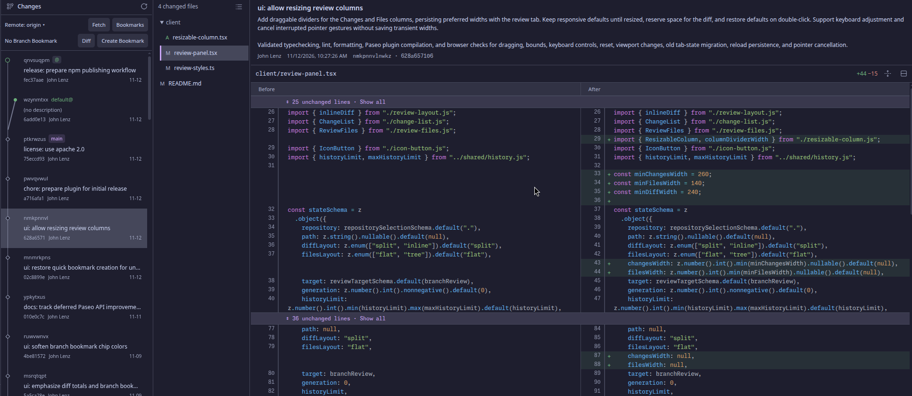

# jj Companion

Jujutsu workspaces, change history, bookmarks, and diff review for Paseo.



## Features

- **Diff review:** single changes, linear ranges, or your branch; inline or side-by-side views with
  syntax highlighting and expandable context.
- **Change graph:** browse history, descriptions, bookmarks, workspace labels, and conflicts.
- **Bookmarks:** create, tug, track, fetch, and push from the review tab.
- **Isolated workspaces:** create jj workspaces through Paseo's **New worktree** picker, with
  optional setup and teardown scripts.
- **Repository switching:** review separate jj repositories in immediate child directories.
- **Persistent layout:** resizable columns, tree/list file views, and saved tab selections.
- **Codex integration:** preserve configured writable roots and add the shared jj/Git paths.

The review interface works on desktop and web; native mobile diff review is not included.

## Requirements

- Paseo **0.15.0+**, with `pluginsEnabled: true` in its config.
- **jj 0.46.0+**, **Git 2.42+**, **Node.js 22.12+**, and **pnpm** on the daemon's PATH.
- A jj repository, colocated or non-colocated.

All commands run on the machine hosting the Paseo daemon. No separate JayJay installation is needed.

## Install

```bash
paseo plugin install https://github.com/wuzzeb/jj-companion-paseo
```

The plugin installs its locked dependencies automatically, using pnpm 12.13.0. To update:

```bash
paseo plugin update jj-companion
```

For a checkout you want to edit, see [local installation](docs/usage.md#local-installation).

## Quick start

Choose **Open jj review** in Paseo's Command Center.

- Click a change to review it; **Shift-click** another to select a linear range.
- Use **Diff** in the branch row to return to your branch comparison, based on jj's `trunk()`.
- Use **Refresh** to include new edits. The displayed diff stays pinned while you browse files.
- Create a bookmark, **Tug** it to the workspace tip, then **Push**. Creating and tugging bookmarks
  uses the workspace tip, regardless of the selected graph row.
- Choose **Local** to keep the current working copy, or **New worktree** for an isolated workspace.

Archiving a plugin-managed workspace removes its directory, **including ignored files**. Restoring
it in Paseo does not recreate those files.

See the [user guide](docs/usage.md) for bookmark behavior, workspace bases, setup/teardown
configuration, cleanup, and Codex sandbox support.

## Development

```bash
pnpm install --frozen-lockfile
pnpm typecheck
pnpm lint
pnpm format:check
pnpm test
```

- [Development notes and JayJay integration](docs/usage.md#development-notes)
- [Release guide](docs/releases.md)
- [Paseo API wishlist](docs/paseo-api-wishlist.md)

## License

Apache-2.0; see [LICENSE](LICENSE). The vendored JayJay renderer retains its
[license and attribution](client/vendor/jayjay/NOTICE.md).
